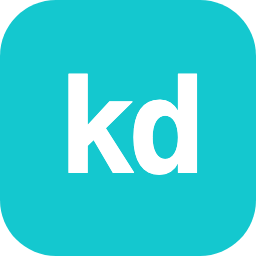
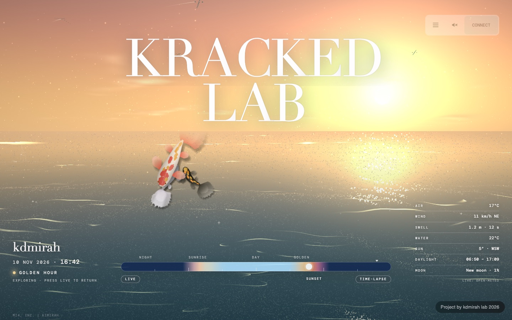
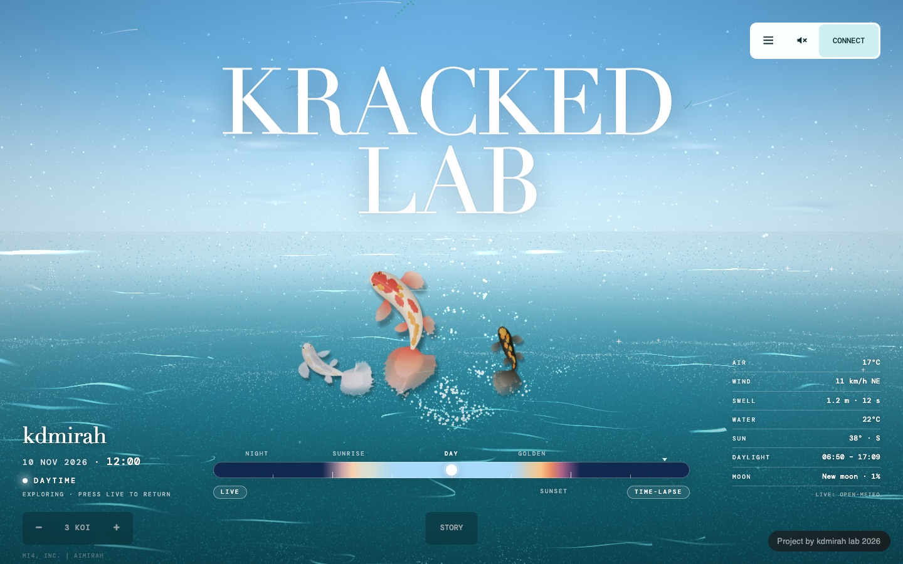
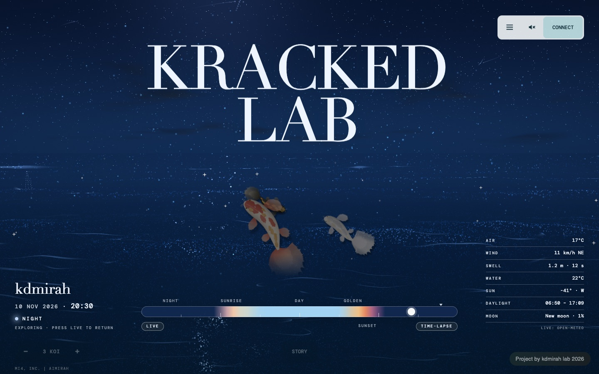
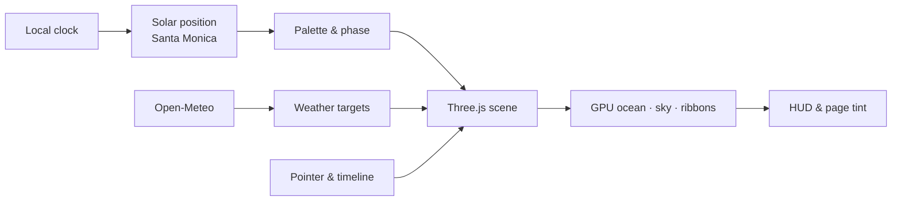

<div align="center">



# KrackedLab

**An interactive digital ocean off Santa Monica — luminous particles that follow your local sky.**

<p>
  <a href="https://kdlabcreative-aimirah.vercel.app"></a>
  
  
  
  
  <a href="https://github.com/strdst7/kdlabcreative-aimirah/commits/main"></a>
</p>

<a href="https://kdlabcreative-aimirah.vercel.app">
  
</a>

<sub><strong>16:42</strong> — golden hour, Santa Monica. Every frame of this README is the live site.</sub>

</div>

## Overview

KrackedLab is a single-page WebGL experience: a particle ocean that reads your local clock, computes the sun's position for Santa Monica (34.02°N, 118.49°W), and repaints the sky, water, and light continuously. There are no preset scenes and no video loops — just shaders, solar geometry, live weather, and three koi.

The scene is deliberately quiet. Type is editorial, the controls sit at the edges, and the ocean fills the rest. It works as a homepage, an ambient display, or a place to leave open on a second monitor.

**Project by [kdmirah lab](https://aimirah.me) 2026 for [MI4, Inc.](https://mi4inc.com) | [aimirah](https://krackeddevs.com).**

## Features

- **Time-adaptive light** — Sun elevation and the day of the year drive every colour: sunrise, daytime, golden hour, sunset, dusk, and night blend continuously through one palette. The page chrome, HUD, and ocean tint all follow the same light.
- **Particle ocean** — Water fills the view below the horizon. Five crossing swells with Gerstner roll, whitecaps, and a glitter path under the sun or moon run entirely on the GPU.
- **Flowing ribbons** — Wave-crest strokes ride the surface; the pointer, gulls, and sailboat leave ribbon wakes.
- **Koi** — Three koi swim in the sea band between horizon and shore, dim at night and fading at the band edges. Use `−` / `+` to change how many swim, or click to drop a coin they chase.
- **Touch the water** — Pointer movement parts the surface and adds parallax; a tap or click sends out a ripple.
- **Scrub the day** — Drag the timeline or use the arrow keys to explore any hour. Chips jump to sunrise, day, golden hour, and sunset; `Live` returns to now, `Time-lapse` plays a whole day.
- **Live conditions** — Air, wind, swell, and water temperature come from [Open-Meteo](https://open-meteo.com) (no key) and also drive wave height, cloud, and wind in the scene. Sun and moon figures are computed locally, so the scene still runs if the weather fetch fails.
- **Sound** — An original looping ocean-and-glass ambient track plays after a user gesture; the speaker button mutes it.

## Gallery

<p align="center">
  <a href="https://kdlabcreative-aimirah.vercel.app/?t=12"></a>
  <a href="https://kdlabcreative-aimirah.vercel.app/?t=20.5"></a>
</p>

<p align="center"><sub><strong>Daytime · 12:00</strong> &nbsp;|&nbsp; <strong>Night · 20:30</strong> &nbsp;— same scene, different light.</sub></p>

## Live demo

**https://kdlabcreative-aimirah.vercel.app**

| Address | Result |
| --- | --- |
| `/` | The beach at your local time |
| `/?t=18.5` | Hold the beach at 18:30 |
| `/?lapse` | Start in time-lapse |
| `/?koi` | The koi pond full screen, without the beach |

## Controls

| Input | Action |
| --- | --- |
| Move pointer | Part the water, add parallax, leave a ribbon wake |
| Click / tap | Send out a ripple |
| Drag the timeline | Scrub to any hour |
| `←` `→` / `↑` `↓` | Step 15 minutes (focus the time slider first) |
| `Shift` + arrows | Step one hour |
| `Home` / `End` | Jump to midnight / end of day |
| `Live` | Return to your local time |
| `Time-lapse` | Play a full day |
| `−` / `+` | Fewer or more koi |
| Speaker | Mute or unmute the ambient track |

## Quick start

The site is static — there is nothing to compile.

```bash
git clone https://github.com/strdst7/kdlabcreative-aimirah.git
cd kdlabcreative-aimirah
npx serve site
# or: python3 -m http.server 8000 -d site
```

Open the printed URL. `npm run build` is intentionally a no-op; it exists so the Vercel build step has something to run.

## Architecture



| Where | What |
| --- | --- |
| `site/index.html` | Page shell. Loads the React app and the beach. |
| `site/beach/main.js` | Time model, weather, input, and the render loop. |
| `site/beach/scene.js` | Three.js scene: particle sets, ribbons, gulls, boat. |
| `site/beach/shaders.js` | GLSL for sky, ocean, and light. |
| `site/beach/palette.js` | Sun and moon geometry, phase names, and colour palettes. |
| `site/beach/hud.js`, `beach.css` | Editorial HUD and timeline. |
| `site/beach/three.module.min.js` | Three.js r160 (MIT, see `THREE-LICENSE.txt`). |
| `site/assets/` | Original React bundle: menu, story panel, ripples, koi mode. |
| `site/audio/` | Generated ambient tracks. |
| `remake/gen/` | Asset generators for the koi sprites and ocean audio. |
| `docs/screenshots/` | Images used in this README. |
| `vercel.json` | Static deployment configuration. |

### How a frame is built

1. The clock supplies an hour; `palette.js` converts it into sun and moon positions, phase, and a full colour palette for the day of the year.
2. Open-Meteo values ease into wave amplitude, cloud, and wind targets; if the network is unavailable, the computed values stay in place.
3. `scene.js` pushes those values into uniforms and updates the particle sets, ribbon trails, gulls, and koi.
4. `hud.js` mirrors the same environment into the clock, conditions panel, and timeline gradient.

## Tech stack

| Layer | Choice |
| --- | --- |
| Rendering | Three.js r160, custom WebGL / GLSL shaders |
| Beach application | Vanilla ES modules, no framework, no bundler |
| Menu & koi mode | Prebuilt React bundle in `site/assets/` |
| Weather | Open-Meteo forecast + marine APIs, no key |
| Audio | Web Audio API; track generated with Python and FFmpeg |
| Asset scripts | Node.js (koi), Python (audio) |
| Hosting | Vercel, static output from `site/` |

## Performance & accessibility

- Particle count scales with screen area and device class.
- Pixel ratio is capped at 1.5 on desktop and 1.25 on mobile, then backs off automatically when frames run slow.
- `prefers-reduced-motion` slows time and disables pointer parallax.
- Without WebGL, the page falls back to a gradient sky instead of failing.
- The timeline is a keyboard-operable slider with live `aria-valuetext`, and the HUD exposes labelled regions for assistive technology.
- Weather is optional: if Open-Meteo is unreachable, the locally computed sun, moon, and palette keep the scene alive.

## Regenerating the original assets

Both generators write into `site/` and are checked in, so you only need them if you change the artwork or the sound.

```bash
# Koi sprites (2048×1016 PNGs). Expects Playwright at ~/.remake.
node remake/gen/make-koi.mjs

# Ocean-and-glass loop. Requires Python 3 and FFmpeg on PATH.
python3 remake/gen/make-ocean-audio.py
```

## Deployment

The repository deploys as a static site. `vercel.json` pins `framework: null`, a no-op build, and `outputDirectory: site`.

```bash
vercel --prod
```

Any static host works: publish the `site/` directory and keep the absolute asset paths intact.

## Credits

- Concept, design, and code: **kdmirah lab 2026** for **MI4, Inc. | aimirah**.
- [Three.js](https://threejs.org) r160, MIT licensed — see `site/beach/THREE-LICENSE.txt`.
- Weather and sea conditions: [Open-Meteo](https://open-meteo.com).
- Built with a [Remake](https://github.com/rubenhassid1/remake) workflow; the page shell and menu descend from a public landing page, with every picture, sound, word, colour, and link replaced.
- Type: Cormorant and DM Mono via Google Fonts.
- Koi sprites and ocean audio are original assets generated in this repository.

## License

[GNU Affero General Public License v3.0](LICENSE). If you run a modified version as a network service, the AGPL requires you to offer its source.
